

  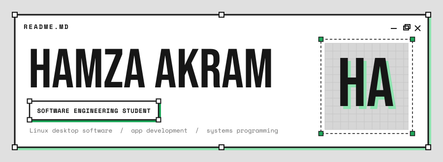

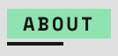

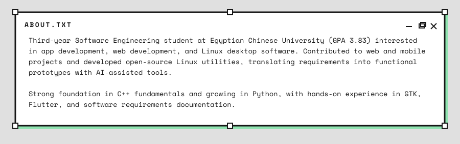

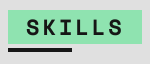

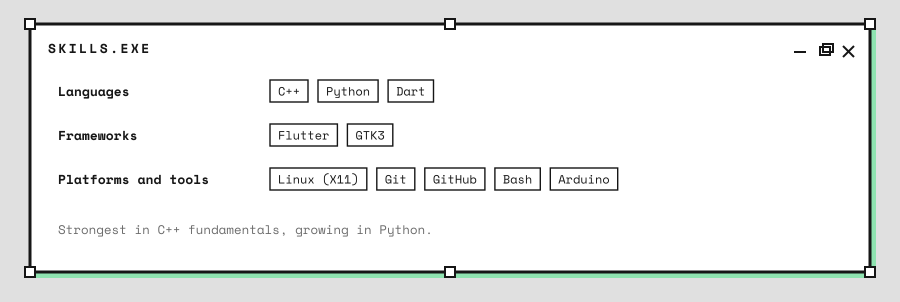

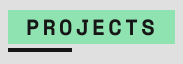

<table>
  <tr>
    <td width="50%"><a href="https://github.com/HamzaAkramv15/glint">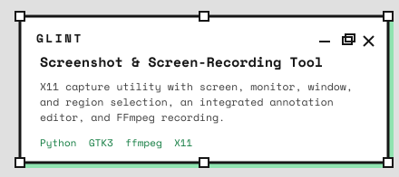</a></td>
    <td width="50%"><a href="https://github.com/HamzaAkramv15/vigil">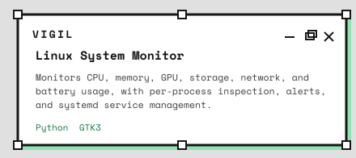</a></td>
  </tr>
  <tr>
    <td width="50%"><a href="https://github.com/HamzaAkramv15/unotes">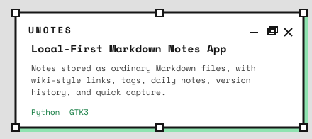</a></td>
    <td width="50%"><a href="https://github.com/HamzaAkramv15/clippy">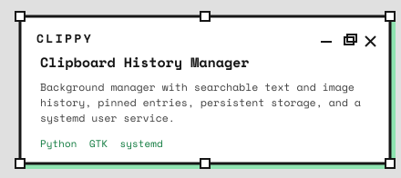</a></td>
  </tr>
  <tr>
    <td width="50%"><a href="https://github.com/HamzaAkramv15/colorchooser">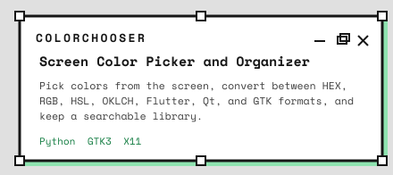</a></td>
    <td width="50%"><a href="https://github.com/HamzaAkramv15/detector">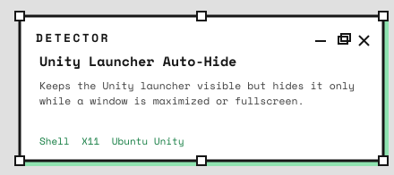</a></td>
  </tr>
  <tr>
    <td width="50%"><a href="https://github.com/HamzaAkramv15/nightlight">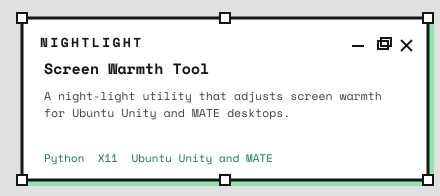</a></td>
    <td width="50%"><a href="https://github.com/HamzaAkramv15/hotcorners">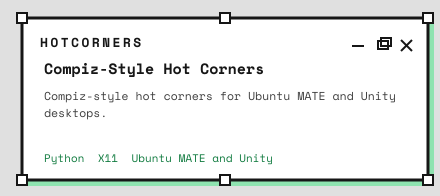</a></td>
  </tr>
</table>

Also built with a team: **Medora**, a health management web application, and **Sage**, a Flutter wellness app paired with an Arduino-based wearable.

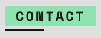

- Email: [hamzawy5c@gmail.com](mailto:hamzawy5c@gmail.com)
- GitHub: [@HamzaAkramv15](https://github.com/HamzaAkramv15)
- University: Egyptian Chinese University
